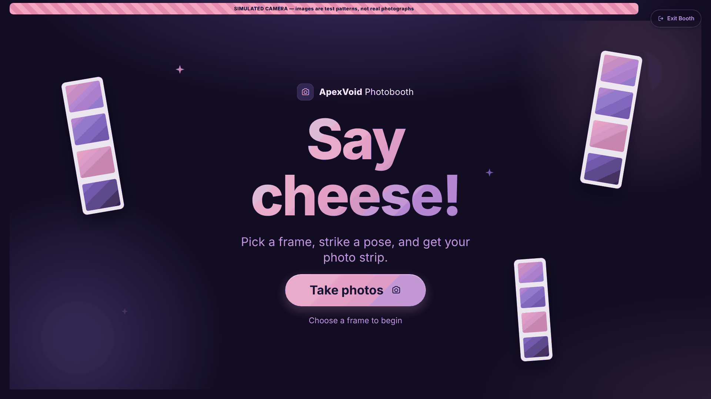

# ApexVoid Photobooth

[](https://github.com/st-mich43l/apexvoid-photobooth/actions/workflows/ci.yml)
[](docs/INSTALL.md)
[](go.mod)
[](https://v3.wails.io/)
[](frontend/package.json)
[](frontend/package.json)
[](docs/ARCHITECTURE.md)
[](docs/INSTALL.md#back-up-and-restore-the-complete-library)

A local-first Windows photobooth for events: connect a camera, guide guests through a touchscreen photo session, compose a frame, manage the media library, and print or export the result. Studio gives the operator setup and recovery controls; Booth Mode provides the guest-facing experience.



*Screenshot from the browser test harness with simulated content; it is not evidence of physical hardware or Windows WebView2 acceptance.*

## Features

- **Guest sessions:** frame selection, live preview, countdown, capture, review, individual retakes and a fullscreen Booth Mode.
- **Cameras:** Canon EDSDK integration for compatible EOS cameras, Windows webcam capture through FFmpeg, and a clearly labelled simulated camera for testing.
- **Frames and printing:** built-in layouts, a frame builder, custom PNG frames, 300/600 DPI composition, Windows printer setup, print history and reprints.
- **Media library:** local SQLite metadata and files, paginated session browsing, search, editing, session ZIP export, recoverable trash and restoration.
- **Operator tools:** setup and readiness checks, a complete English/Vietnamese interface, an independent guest-language preference, offline support diagnostics, and library backup and recovery guidance.

## Download and run

1. Open the latest **successful master** [CI run](https://github.com/st-mich43l/apexvoid-photobooth/actions/workflows/ci.yml?query=branch%3Amaster) and download **ApexVoidPhotobooth-windows-x64**. GitHub wraps the artifact in a ZIP; the ZIP contains one file: `ApexVoidPhotobooth.exe`.
2. Extract and run the executable on Windows 10 or 11 x64. The build is unsigned. Microsoft Edge WebView2 Evergreen Runtime must be installed; see [installation instructions](docs/INSTALL.md) for online and offline setup.
3. On first use, the app automatically extracts its embedded Canon EDSDK DLLs and FFmpeg into the current user's cache. No separate SDK or FFmpeg installation is required for this build. An explicitly configured or nearby SDK/FFmpeg can take precedence.
4. Connect a compatible camera and select it in **Studio → Camera**. To explore without hardware, enable **Simulated camera** in Settings and connect the simulated device.

The portable executable keeps photos, session metadata and settings outside the application file. The default media library is `Documents\apexvoid-studio`; settings are stored separately under `%APPDATA%\ApexVoidPhotobooth`. See [Install and recovery](docs/INSTALL.md) before moving or backing up a library.

## Verification and hardware status

CI runs Go tests and race checks, frontend type checking and tests, simulated session endurance, Windows builds, executable self-tests, and Windows spooler/GDI checks where a file-port printer is available. Trusted master builds also validate Canon SDK extraction and initialization on Windows. Pull requests do not receive the vault password and do not publish the Canon-enabled artifact.

The Canon EOS R50, real webcams, physical printer output, Windows touchscreen/WebView2 journey, and power-loss recovery require testing on the target hardware. Software tests and a software printer do not establish physical delivery or production readiness. See [Hardware tests](docs/HARDWARE_TESTS.md).

## Development

Prerequisites: Go 1.26, Node.js 22 and npm. FFmpeg is needed for local webcam/video tests; the ordinary `go build` below does not embed FFmpeg or Canon DLLs.

```sh
cd frontend
npm ci
npm run typecheck
npm test
npm run build
cd ..

go test ./internal/...
CGO_ENABLED=0 GOOS=windows GOARCH=amd64 go build \\
  -ldflags "-H windowsgui -s -w" \\
  -o ApexVoidPhotobooth.exe ./cmd/photobooth
```

The production-style CI build embeds both dependencies and Windows resources. Run `ApexVoidPhotobooth.exe --notices notices.txt` to export the bundled third-party license notices to a new file. See [local Canon build instructions](docs/INSTALL.md#local-portable-build-with-canon-edsdk) and [third-party notices](docs/THIRD-PARTY.md).

## Documentation

| Guide | Contents |
| --- | --- |
| [Install and recovery](docs/INSTALL.md) | Portable build, prerequisites, backup, restore and troubleshooting |
| [Cameras](docs/CAMERAS.md) | Canon and webcam setup, supported behavior and limitations |
| [Printing](docs/PRINTING.md) | Printer setup, calibration, spooler status and reprints |
| [Frames](docs/FRAMES.md) | Frame layouts, the builder and custom artwork |
| [Hardware tests](docs/HARDWARE_TESTS.md) | Device, touchscreen, filesystem and endurance test procedures |
| [Architecture](docs/ARCHITECTURE.md) | Application components and design decisions |
| [Third-party notices](docs/THIRD-PARTY.md) | Embedded components and their notices |

### Interface languages

Studio and Booth support English and Vietnamese. The operator language persists independently from the configurable guest default; guests may choose a temporary language at the Booth welcome screen. Native Windows and hardware acceptance procedures are documented in [Hardware tests](docs/HARDWARE_TESTS.md).
