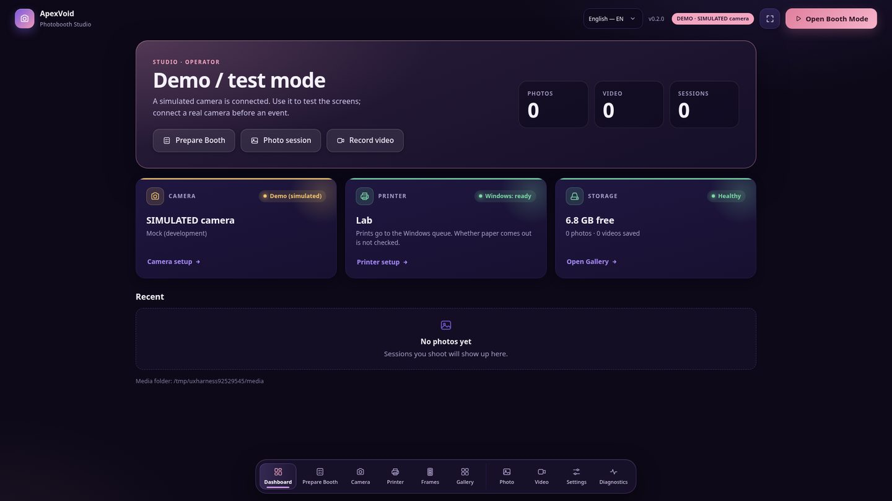
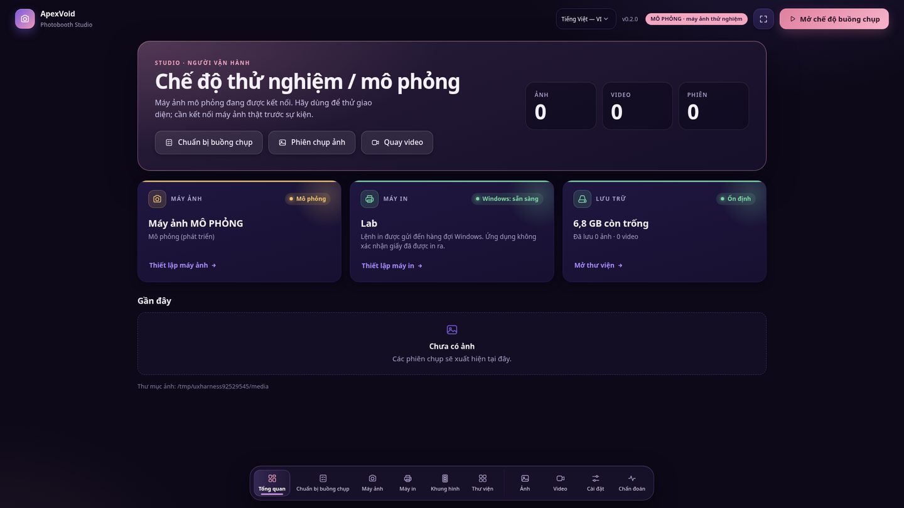
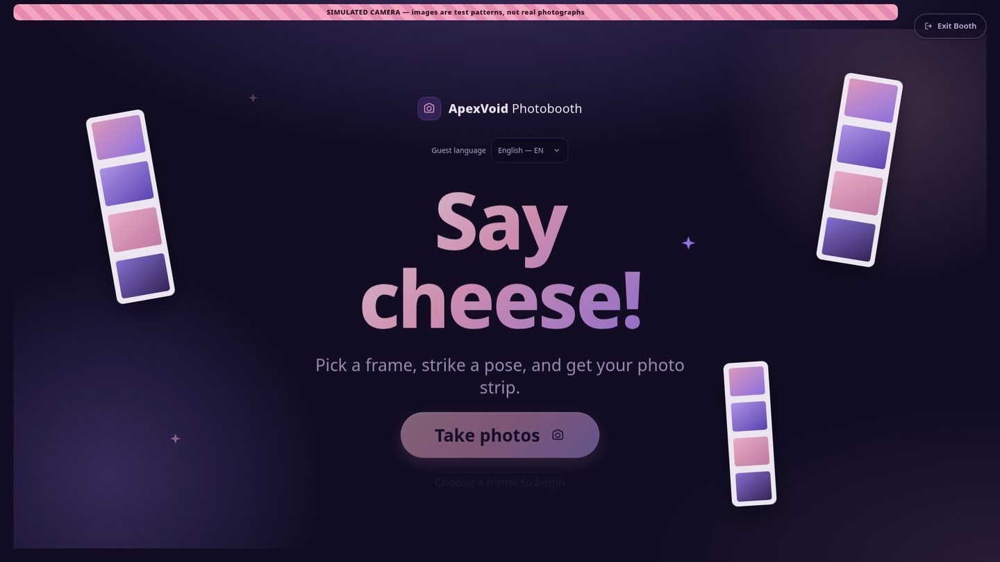
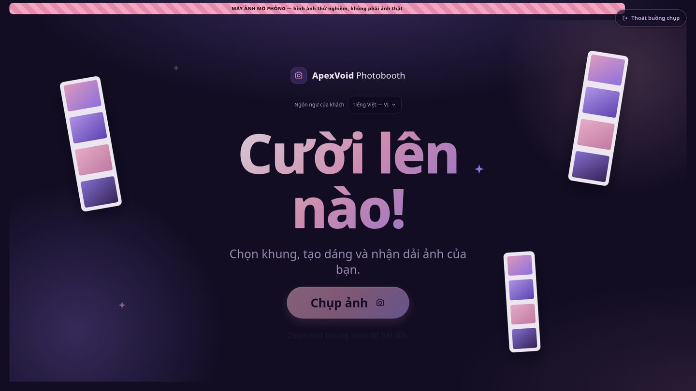
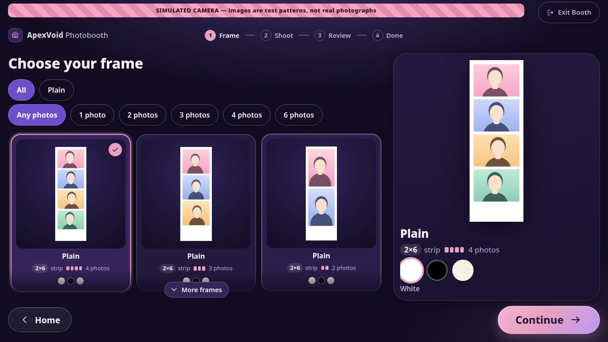
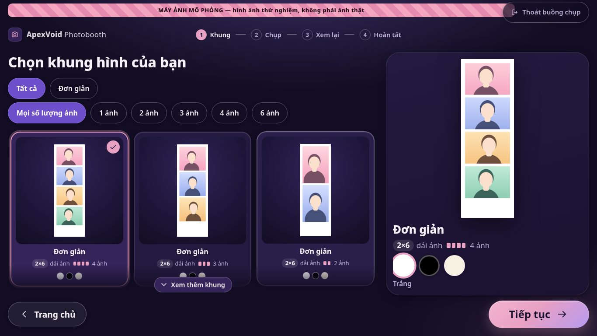
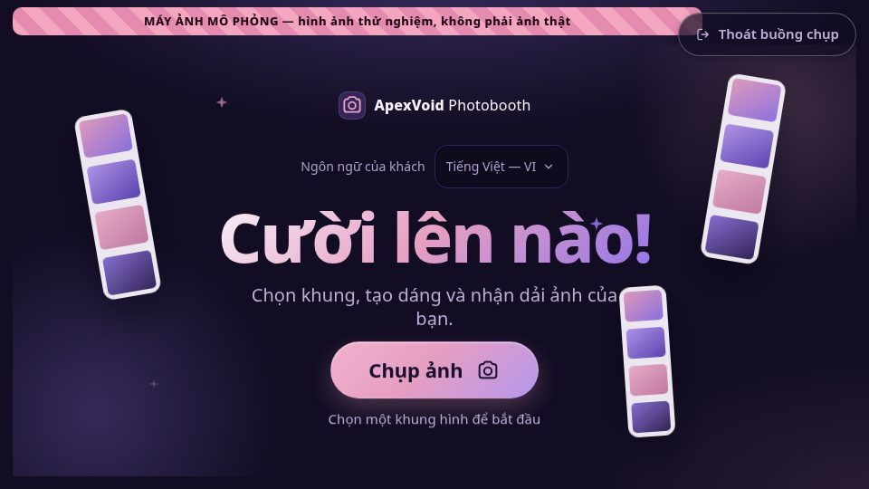

# UX7 English and Vietnamese implementation audit

Status: **software implementation complete; Windows and physical-device acceptance remains unverified.** This audit records the code and Linux browser-harness evidence for UX7. It does not claim that WebView2, Canon hardware, Windows display scaling or a physical printer has been accepted.

## Scope and baseline

The implementation is based on `4e2c63e1ad3e5b6c5312343ce41c1c7340761461` plus merged PRs #41, #46–#48, #50–#53. Those changes established the existing typed dictionary, device and gallery screens, crop preview, portable single-file CI packaging, reduced sample-frame catalogue and floating Studio navigation. UX7 extends these in place and keeps the existing English-default settings and Wails bindings.

The baseline frontend suite passed 319 tests on one run; a separate run had one intermittent asynchronous Gallery thumbnail failure. The race was subsequently fixed by making thumbnail error state specific to the current source URL. Linux cannot build the Wails desktop target here without GTK/WebKit development packages. Go integration tests need loopback permission in this environment.

## Implemented

- **Localization foundation:** English and Vietnamese use the existing typed keys and `translate`, `formatTranslation`, `t` and `tf` APIs. Tests verify complete key parity, duplicate keys across dictionary domains, nonempty values and named interpolation parity. Unsupported language values fall back to English. Quantities use the existing English singular/plural messages and natural Vietnamese quantity wording. Dates and file sizes use `Intl` with `en-US` and `vi-VN`; stored timestamps, numbers, identifiers and protocols are unchanged.
- **Operator language:** a reusable native-name EN/VI switcher is integrated into Studio and Settings. Switching applies immediately through a targeted settings patch, handles write failure by reverting the UI choice, and does not replace the app tree or active camera/recording state. `document.documentElement.lang` follows the active operator or scoped guest locale.
- **Guest language:** `guestLanguage` is a validated, optional setting defaulting to English for older configuration. The Booth welcome selector initializes from that setting; the selected language is transient and survives the guest flow. The selector disappears after the workflow begins. Completion and cancellation dispose the guest locale, and Booth exit restores the operator locale without writing guest choice to settings.
- **Screen coverage:** application-authored labels, instructions, controls and accessibility names are localized across Dashboard, Prepare Booth, Camera, Printer, Photo, Video, Gallery, frame management and builder, Editor, Settings, Diagnostics, shared UI and the complete guest journey. Built-in frame names, variants and categories translate only at presentation time; stored names, category identifiers, custom frame names and saved compositions are preserved. Frame captions are rendered with Vietnamese glyph coverage and tested for actual pixel output.
- **Errors and recovery:** frontend errors carry stable application codes with safe parameters and an optional recovery action. Go Wails methods return JSON result objects for PIN operations because Wails converts Go `error` values into plain JS `Error` messages. Existing PIN methods remain available. Diagnostic strings stay available for operator troubleshooting; guest recovery messages are localized and avoid leaking paths. No language behavior depends on substring-matching arbitrary English errors. Print/camera/system-driver details supplied by Windows or third parties remain verbatim and are presented as technical details where applicable.
- **Layout and accessibility:** Vietnamese labels and screen readers use translated names; browser harness journeys cover the three requested CSS viewports. Window minimum size is lowered to 640×360 logical pixels so compact high-DPI Windows layouts are not blocked by the previous 900×620 minimum. This is a sizing safeguard, not a substitute for physical Windows testing.
- **Documentation and evidence:** representative simulated-harness screenshots are below. They contain no real camera imagery or personal library paths.

| Studio · English | Studio · Tiếng Việt |
|---|---|
|  |  |

| Booth welcome · English | Booth welcome · Tiếng Việt |
|---|---|
|  |  |

| Guest frame picker · 1366×768 English | Guest frame picker · 1366×768 Tiếng Việt |
|---|---|
|  |  |

## Validation performed

The repository CI and local verification results are recorded in the PR and final delivery report. The browser harness used the simulated camera and fake printer. It completed Welcome → Frame Selection → Preview → Capture → Review → Retake → Result → Print → Finish in English and Vietnamese at 1920×1080, 1080×1920 and 1366×768, plus language-layout checks at 100%, 125%, 150% and 200% simulated browser scaling. No document-level horizontal overflow or clipped interactive buttons were observed in those captures. Vietnamese built-in frame names were visible in the localized chooser.

Browser scaling emulation cannot verify actual Windows DPI behavior, native title bar, font rasterization, touch input, physical camera recovery, print delivery, or PowerShell/driver messages. It does not demonstrate OS-level persistence/restart or accept real hardware. See [`UX6_WINDOWS_ACCEPTANCE.md`](UX6_WINDOWS_ACCEPTANCE.md) for the target-PC protocol.

## Remaining external text and acceptance

- OS-, driver-, Canon SDK-, FFmpeg-, printer- and third-party-provided names and diagnostic strings retain their source language. Application-owned summaries and recovery instructions around them are translated; the original technical details remain available to operators.
- The current Go/CI build and browser harness do not provide a Windows WebView2 session or physical devices. Complete the real Windows, Canon, webcam, printer, touchscreen, scale, restart and endurance matrix in `UX6_WINDOWS_ACCEPTANCE.md`, and record results in `UX6_HARDWARE_RESULTS.md` before making a production hardware-acceptance claim.
- Trusted Canon portable artifacts are produced only by the protected master workflow. Pull requests do not receive the vault password and cannot validate SDK extraction against the trusted secret. The portable artifact remains a single executable; no additional release artifact is introduced by UX7.

## Changed-module map

| Area | Implementation |
|---|---|
| Locale state and dictionary | `frontend/src/i18n.ts`, `locale.tsx`, `LanguageSwitcher.tsx`, `state.tsx`, `types.ts` |
| Guest and Studio flows | `Booth.tsx`, `guest/`, `ShootFlow.tsx`, `VideoFlow.tsx`, `ExitDialog.tsx`, `FrameSelection.tsx` |
| Operator, builder and library | `operator/`, `builder/`, `pages/`, `frameInfo.ts`, `format.ts` |
| Error/recovery contracts | `api.ts`, `safeExit.ts`, `internal/app/settings_api.go`, `internal/app/diag_api.go`, `internal/app/canon_api.go`, `internal/capture/capture.go` |
| Rendering and regression tests | `internal/templates/vietnamese_test.go`, locale, guest, API, PIN, capture and existing app tests |
| Native compact layout | `cmd/photobooth/main.go` |
